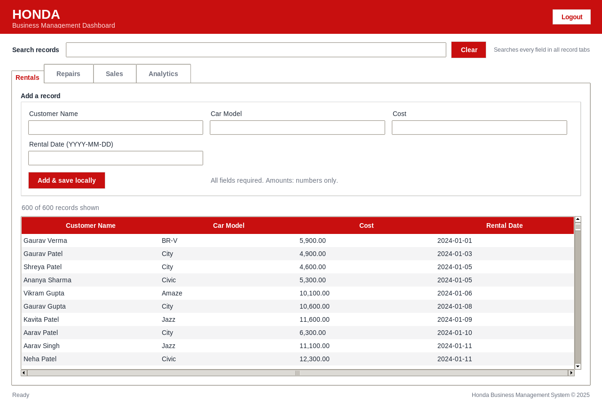
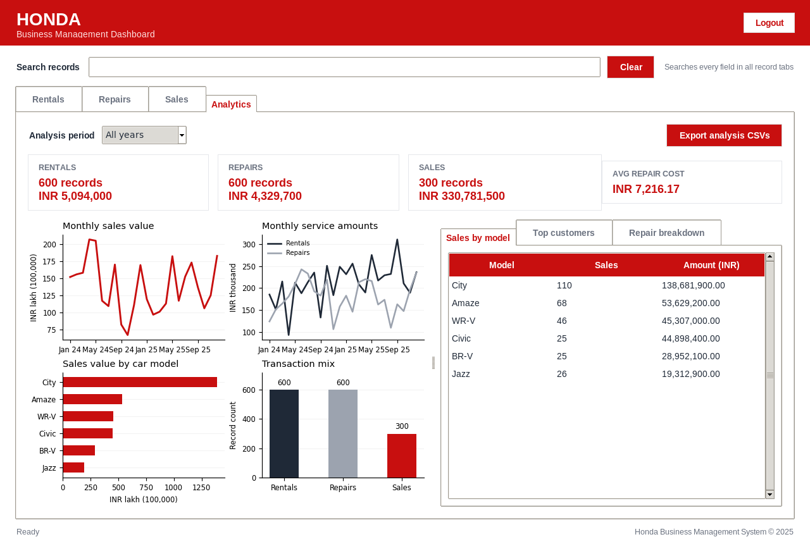

# Honda Business Management Dashboard

A Python desktop app for managing rentals, repairs and vehicle sales. Tkinter provides the interface, Excel stores the records, and pandas powers the analysis.

The app ships with a sample transaction dataset of 1,500 records (600 rentals, 600 repairs, 300 sales) covering 2024-2025, so every table, chart and report works right after download.

## What it does

- Sign-in screen that opens the dashboard (use **admin / 1234**).
- Browse rental, repair and sales tables with vertical and horizontal scrolling.
- Live search across every field in all record tabs.
- Add records with required-field, date and amount validation.
- Additions save to local Excel working copies; the shipped sample workbooks are never changed.
- Analytics workspace with a calendar-year filter, or all years.
- Monthly sales trend, monthly rental/repair amounts, sales value by car model and the transaction mix.
- Sales by model, top 10 customers by recorded amount, and repair-issue breakdowns with average cost.
- KPI cards: record counts, recorded amounts per category and average repair cost.
- Export five analysis CSV reports for the selected period.

**Scope:** a single-user, local desktop app. It does not include record editing/deletion, inventory management, payments, profit calculations or a web deployment.

## Screenshots

### Record workspace



### Analysis workspace



To refresh these after changes, run the app and replace the two PNG files with your own captures.

## Tech stack

- Python 3.10 or newer
- Tkinter / ttk: desktop interface
- pandas: cleaning, filtering, reshaping and aggregation
- Matplotlib: embedded charts
- openpyxl: Excel reading and writing
- unittest: regression tests (Python standard library)

Tested on Python 3.10 with pandas 2.3.3, Matplotlib 3.10.9 and openpyxl 3.1.5 on Linux.

## Run locally

Download the project files into **one folder**. Keep the three `.xlsx` files beside `app.py`.

```text
honda-dashboard/
  app.py
  analysis.py
  generate_demo_data.py
  test_project.py
  Rentals.xlsx
  Repairs.xlsx
  Sales.xlsx
  requirements.txt
  README.md
  .gitignore
  records.png
  analytics.png
```

Create and activate a virtual environment:

```bash
python -m venv .venv
```

Windows PowerShell:

```powershell
.venv\Scripts\Activate.ps1
```

macOS / Linux:

```bash
source .venv/bin/activate
```

Then install and launch:

```bash
python -m pip install -r requirements.txt
python app.py
```

On systems where the command is `python3`, use that instead of `python`. Tkinter is not a pip dependency. Check it with `python -m tkinter`. If it is missing, install Tk support for your Python distribution. On Debian/Ubuntu system Python, that is commonly `sudo apt install python3-tk`; on Windows/macOS, use a Python installation that includes Tcl/Tk. A graphical desktop with at least a 1080 x 760 workspace is required. The dashboard window is 1280 x 860.

## Use the dashboard

1. Sign in with **admin / 1234**.
2. Open a record tab and browse or search for a model or customer.
3. Fill every form field. Dates use `YYYY-MM-DD`; amounts use plain numbers with up to two decimal places, without commas or currency symbols.
4. Choose **Add & save locally**. The status line confirms the local path. If search hides your new record, choose **Clear**.
5. Open **Analytics**, pick the year, and explore the charts plus the **Sales by model**, **Top customers** and **Repair breakdown** tables.
6. Choose **Export analysis CSVs**. Reports go to `exports/all-years/` or `exports/<year>/`; another export for the same period replaces those reports.

The KPI cards follow the **analysis period**, not the search query. Search changes record tables only. Analysis always uses all records within its selected year.

## Data

| Workbook | Records | Date field | Amount field |
| --- | ---: | --- | --- |
| Rentals.xlsx | 600 | Rental Date | Cost |
| Repairs.xlsx | 600 | DATE | COST |
| Sales.xlsx | 300 | SALE_DATE | SALE_PRICE |

All dates fall in **2024-2025** and all amounts are **INR**. Customer names repeat across categories so customer-level aggregation can be demonstrated. There are no transaction IDs; rows are counted as transactions.

Regenerate the same sample records:

```bash
python generate_demo_data.py --overwrite
```

This replaces the three **sample** workbooks only (seed `2025`, so the output is identical every time). It does not change existing local working copies in `data/`. Without `--overwrite`, generation stops if a sample file already exists.

### What the pandas analysis demonstrates

`analysis.py` is separate from the UI and can be read or reused on its own:

- Select and rename columns from three workbook schemas into one tidy transaction table.
- Parse dates and numeric amounts explicitly.
- Filter calendar-year cohorts with `.dt.year`.
- Aggregate counts, sums, means and unique customers with `groupby().agg()`.
- Build monthly trends with `pd.Grouper`, `unstack()` and `reindex()`, filling missing months with zeros.
- Rank car models and customers using grouped totals and deterministic tie-breaking.
- Export structured summary tables as CSV.

The monthly charts separate sales from service amounts because their scales differ. One lakh means 100,000 INR. Recorded amounts are **not profit or verified cash receipts**; there are no payment-status or expense fields.

## Files and local persistence

On launch, each category loads from `data/<Category>.xlsx` if that working copy exists; otherwise it uses the sample file beside `app.py`. Adding a record saves a complete working copy for that category using a temporary file and atomic replacement. The UI updates only after the save succeeds.

- `data/` contains local records and is ignored by Git.
- `exports/` contains generated reports and is ignored by Git.
- Sample spreadsheets remain tracked so a fresh download works immediately.
- To reset, close the app, **back up any records you need**, then remove the relevant working copy from `data/`. The next launch uses the sample for that category again.
- Keep workbook headers unchanged. A missing file, invalid date/amount, blank field or schema mismatch is reported on startup rather than silently discarded.
- Only run one app instance against a folder at a time. There is no multi-user locking or automatic backup. Keep backups of important data.

## Tests

```bash
python -m unittest -v test_project
```

Tests use temporary directories. They check dataset size/reproducibility, validation, literal search, save/reload behavior, failed-write rollback, monthly aggregation, year filtering, model/customer rankings and CSV export. Tk support and project dependencies must be installed, but the tests do not open windows.

## Author

Priyanshu Kumari Paswan
